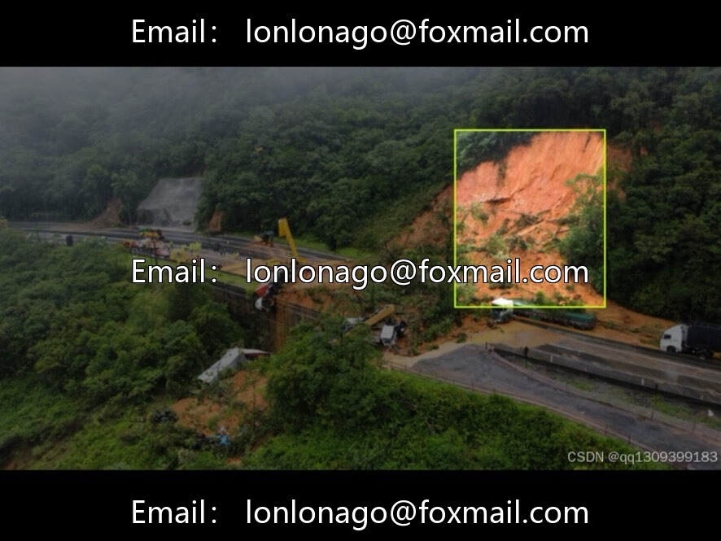
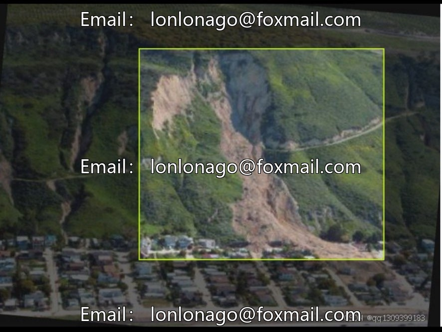
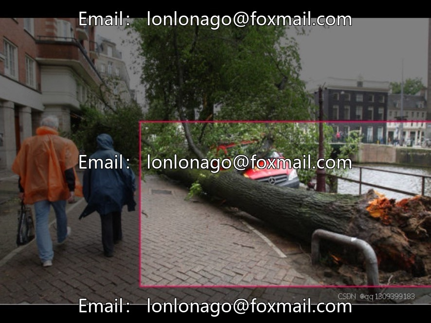
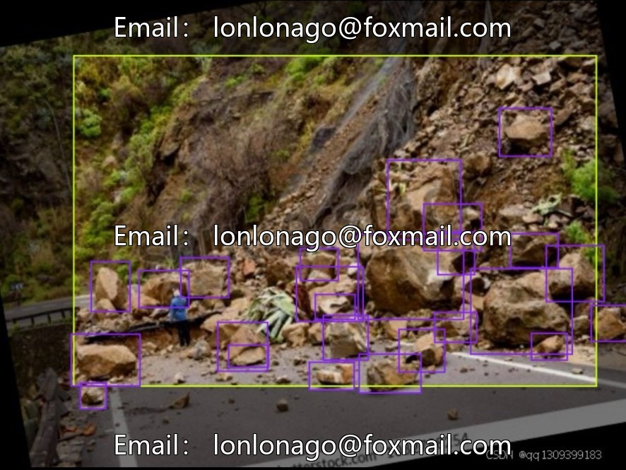

# Drone aerial photography disaster detection dataset

## Body

Drone aerial photography disaster detection dataset, drone aerial photography natural disaster target detection dataset, issue 10068

Contains 9085 aerial imagery of drones, with annotation format in YOLO series txt, supporting mainstream target detection frameworks. The categories include fallen trees, landslides, road collapses, stones/fallen rocks, suitable for highway inspection, mountain monitoring, emergency rescue and other scenarios.

The dataset is large in size, suitable for algorithm research such as disaster detection baseline tasks, small target detection, and adaptability in the field of aerial photography. In the category, directly develop and verify outdoor safety monitoring systems. Recommendations for enhancing model generalization capabilities with data augmentation.

Virtual materials, once sold, are non-refundable.
Interested friends, click "I want" to proceed.

## Images

## Payment

Here is a pay link on Stripe ( https://buy.stripe.com/3cs8yP7sY87d0vu9AB ). Please contact me lonlonago@foxmail.com after funding $89, and I will send you a complete data files , thank you!

